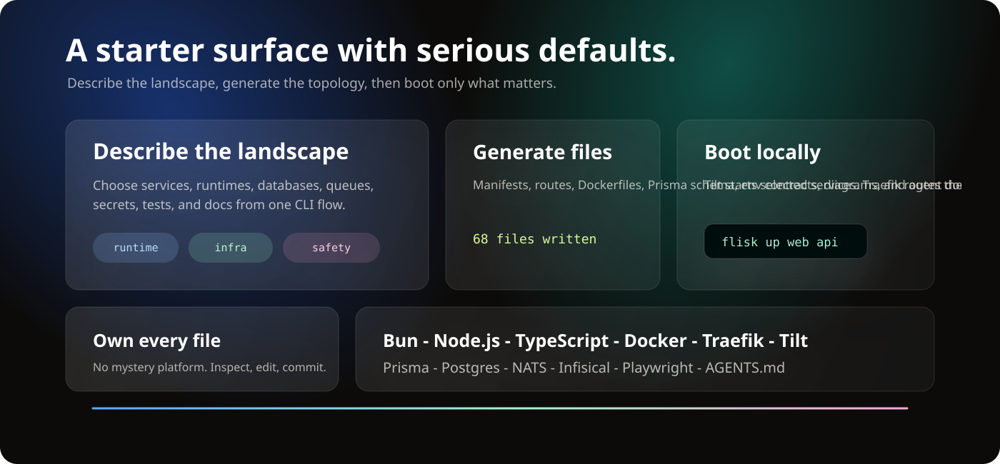
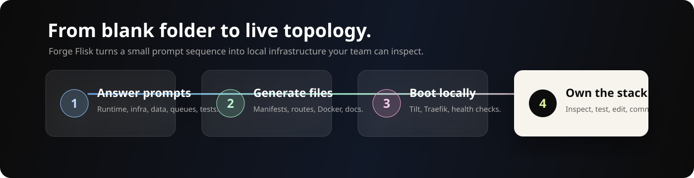

<!-- markdownlint-disable MD013 MD033 MD041 -->

<p align="center">
  
</p>

<p align="center">
  <a href="#run-it">Run it</a>
  &nbsp;&nbsp;/&nbsp;&nbsp;
  <a href="#what-this-is">What this is</a>
  &nbsp;&nbsp;/&nbsp;&nbsp;
  <a href="#inside-the-page">Inside the page</a>
  &nbsp;&nbsp;/&nbsp;&nbsp;
  <a href="#ship-it">Ship it</a>
  &nbsp;&nbsp;/&nbsp;&nbsp;
  <a href="https://github.com/tdk-landscape/tdk-cli-core">TDK CLI</a>
</p>

<br>

## Forge TDK

`create-tdk-stack` is a polished landing page and starter surface for the TDK CLI: the create-t3-app idea, reimagined for local-first microservice systems.

It presents the generated stack story in one focused React/Vite experience: Bun, Node.js, TypeScript, Docker, Traefik, Tilt, Prisma, PostgreSQL, NATS JetStream, Infisical, Playwright, C4 diagrams, and `AGENTS.md`.

<p align="center">
  
</p>

> ⭐ **This page showcases [TDK CLI](https://github.com/tdk-landscape/tdk-cli-core).** If you like it, [star tdk-cli-core on GitHub](https://github.com/tdk-landscape/tdk-cli-core) so other developers can find it.

---

## Run It

### Prerequisites

- [Node.js 22+](https://nodejs.org/) for the local Vite app and GitHub Pages workflow parity.
- npm, included with Node.js.

```bash
git clone https://github.com/tdk-landscape/create-tdk-stack.git
cd create-tdk-stack

npm install
npm run dev
```

The dev server binds to `127.0.0.1` from `package.json`.

```bash
# Build the static site
npm run build

# Preview the production build locally
npm run preview
```

---

## What This Is

Forge TDK is not the generated microservice stack itself. It is the front door: a fast, visual explanation of creating a local-first microservice project with `npm init @tdk-landscape/microservices`.

The page frames the starter around three ideas:

| Promise | What the UI communicates |
| --- | --- |
| Describe the landscape | Pick service types, runtimes, databases, events, tests, secrets, and docs from one CLI flow. |
| Generate the topology | Produce manifests, Dockerfiles, routes, environment contracts, diagrams, and runnable service code. |
| Boot only what matters | Use Tilt and Traefik to start selected services with hot reload and healthy local URLs. |

<p align="center">
  
</p>

---

## Inside The Page

The app is intentionally small, but the interaction layer is rich enough to sell the product idea:

- Sticky glass navigation with direct jumps to stack, flow, and community sections.
- Cinematic hero with copyable `npm init @tdk-landscape/microservices` command.
- Animated terminal simulation showing the scaffold journey.
- Infinite technology marquee for the generated stack.
- Dense stack grid using Lucide icons for the core tools.
- Scroll-scrubbed manifesto text and pinned build-flow cards powered by GSAP ScrollTrigger.
- High-contrast call to action linking back to the TDK Landscape ecosystem.

```text
create-tdk-stack/
├── .github/workflows/pages.yml
├── docs/
│   ├── readme-bento.svg
│   ├── readme-flow.svg
│   ├── readme-hero.svg
│   └── readme-marquee.svg
├── public/
│   └── favicon.svg
├── src/
│   ├── main.jsx
│   └── styles.css
├── index.html
├── package.json
└── vite.config.js
```

---

## Tech Stack

| Layer | Choice |
| --- | --- |
| App shell | React + Vite |
| Motion | GSAP + ScrollTrigger |
| Icons | Lucide React |
| Styling | Plain CSS with responsive layout and custom effects |
| Build output | Static assets in `dist/` |
| Deployment | GitHub Pages |

The Vite config uses:

```js
base: '/create-tdk-stack/'
```

That keeps asset paths correct when the site is published under the repository path on GitHub Pages.

---

## Ship It

GitHub Pages deployment is already wired in `.github/workflows/pages.yml`.

```bash
git push origin main
```

On every push to `main`, the workflow:

1. Installs dependencies with `npm ci`.
2. Builds the site with `npm run build`.
3. Uploads `dist/` as a Pages artifact.
4. Deploys the static site to GitHub Pages.

You can also trigger the workflow manually from GitHub Actions with `workflow_dispatch`.

---

## The Generated Stack Story

<p align="center">
  
</p>

Forge TDK positions the CLI around a simple path:

```text
answer prompts
  -> generate files
  -> boot locally
  -> inspect, test, and own the stack
```

The product promise is intentionally direct: start small, keep the whole landscape, and avoid mystery infrastructure.

---

<p align="center">
  <strong>Start the stack story. Generate the topology. Keep every file understandable.</strong>
</p>

<p align="center">
  <a href="https://github.com/tdk-landscape">TDK Landscape</a>
  &nbsp;&nbsp;/&nbsp;&nbsp;
  <a href="https://github.com/tdk-landscape/tdk-cli-core">TDK CLI</a>
  &nbsp;&nbsp;/&nbsp;&nbsp;
  <a href="https://github.com/tdk-landscape/create-tdk-stack">Repository</a>
  &nbsp;&nbsp;/&nbsp;&nbsp;
  MIT License
</p>

---

## Package Registries

This repository can be distributed as `@tdk-landscape/create-tdk-stack` through npm and GitHub Packages. The package contains the built landing page and its app sources; it does **not** install a `create-tdk-stack` executable or scaffold generated microservice projects.

### Install from npm

```bash
npm install @tdk-landscape/create-tdk-stack
```

### Install from GitHub Packages

Configure the `@tdk-landscape` scope to use GitHub Packages and authenticate with a GitHub personal access token (classic) that has `read:packages` access:

```ini
# ~/.npmrc
@tdk-landscape:registry=https://npm.pkg.github.com
//npm.pkg.github.com/:_authToken=YOUR_GITHUB_TOKEN
```

Then install the package:

```bash
npm install @tdk-landscape/create-tdk-stack
```

Keep the token private; do not commit it to a repository.

### Maintainer release

The registry release workflow runs only for a published GitHub Release. Before the first release, maintainers must add an npm publishing token as the repository Actions secret `NPM_TOKEN`, confirm that the npm organization grants package publishing access, and confirm the repository's GitHub Actions token can write packages. The workflow requires the release tag to match the package version (`v0.1.0` for version `0.1.0`), builds and validates one package archive, then publishes that same archive to both registries.

Create a release from a matching version tag after updating `package.json` and `package-lock.json`. The Pages workflow remains separate and continues to deploy on pushes to `main`.

If one registry publish succeeds and the other fails, use the retained `create-tdk-stack-package` workflow artifact to identify the exact package archive and version. Retry only the registry that failed if it accepts that version; otherwise increment the version and publish a new release to both registries.
